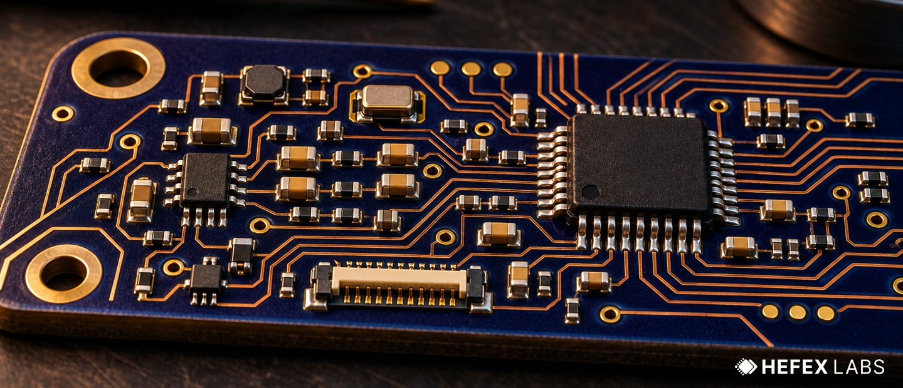

# PCB Skills



Check a KiCad design before fabrication, review what changed between revisions, or export a KiCad or Altium board as ODB++. These [Hefex Labs](https://hefex-labs.com) skills work on local design files in your coding assistant.

| Skill | Try asking |
| --- | --- |
| [PCB preflight](pcb-preflight/SKILL.md) · KiCad | “Check this board before fabrication. Show me the components or nets behind each finding.” |
| [PCB revision review](pcb-revision-review/SKILL.md) · KiCad | “Compare rev A with rev B. What changed, and which manufacturing files should I regenerate?” |
| [ODB++ export](odbpp-export/SKILL.md) · KiCad and Altium Designer | “Export this board as ODB++. Check the assembly variant with me first.” |

## Install once

Paste this into Codex or Claude Code:

> Install the PCB skills from https://github.com/Hefex-Labs/pcb-skills for my user account.

Then open a board project in your assistant and try one of the requests above.

<details>
<summary>Install from a terminal</summary>

With Node.js 22.20 or later, run the command for your assistant from any folder.

**Codex**

```sh
npx skills add Hefex-Labs/pcb-skills --skill pcb-preflight pcb-revision-review odbpp-export --global -a codex
```

**Claude Code**

```sh
npx skills add Hefex-Labs/pcb-skills --skill pcb-preflight pcb-revision-review odbpp-export --global -a claude-code
```

See the [installer documentation](https://github.com/vercel-labs/skills#install-a-skill) for other supported agents.

</details>

## From design to assembly

The preflight uses KiCad’s electrical and design rule checks. The ODB++ exporter works with KiCad 9 and 10. For a named assembly variant, use a version whose `pcb export odb --help` lists `--variant`. On Windows, the Altium export kit was originally tested with Designer 26 Standard.

Ready to price the board? [Upload the ODB++ archive to Hefex](https://prototyping.hefex-labs.com) or [connect your assistant](https://prototyping.hefex-labs.com/agents) and ask for a quote.
